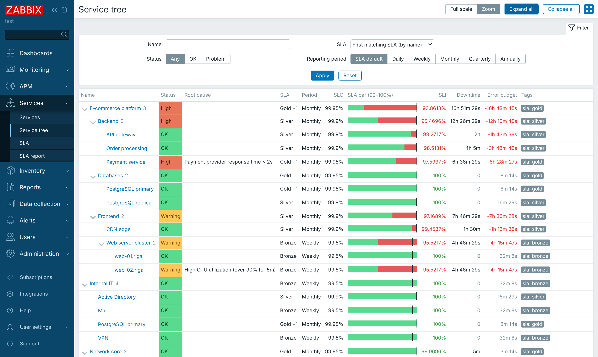
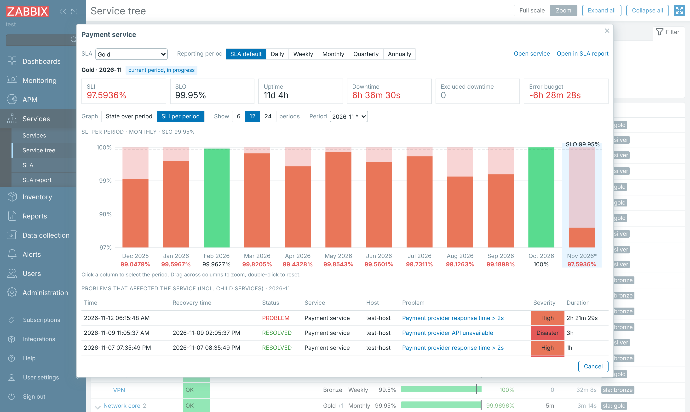

# Service tree for Zabbix

A Zabbix frontend module that shows your **services as an expandable tree** with an **SLA bar for every service**.
Click a bar to see how the service's state changed over the reporting period, its SLI history, and the
problems that affected it.


*Service tree with SLA bars (zoomed scale), SLO markers, SLI, downtime and error budget per service.*


*SLA popup: KPIs for the current period, SLI of the last 12 periods against the SLO, and the problems that affected the service.*


*State over period: status changes of the service during the month. Drag across the graph to zoom in; the problem list follows the selected time range.*

## Features

- **Expandable parent/child tree** of all services you have access to. A service with several parents is shown
  under each of them. Expanded rows are remembered in the browser.
- **SLA bar per service.** The bar is 100% of the elapsed time of the current reporting period, split into
  uptime (green), excluded downtime (grey) and downtime (red). A black marker shows the SLO.
  - *Full scale* shows 0–100%.
  - *Zoom* starts the axis just below the lowest value on the page, so short outages are visible.
- **Columns:** status, root cause, SLA, reporting period, SLO, SLI, downtime, error budget and tags.
- **Filter** by name, status, SLA and reporting period (SLA default, daily, weekly, monthly, quarterly, annually).
- **SLA popup** (click a bar):
  - KPIs for the selected period: SLI, SLO, uptime, downtime, excluded downtime, error budget.
  - *State over period*: step graph of the service status with a coloured state strip.
  - *SLI per period*: the last 6 / 12 / 24 periods with the SLO line; click a column to select that period.
  - Switch SLA (when the service matches several) and reporting period.
  - **Drag across a graph with the mouse to zoom.** The problem list is filtered to the selected time range.
    Double-click or *Reset zoom* to go back.
  - **Problems that affected the service** or any of its child services: the latest 50 by default, 20 per page.
- Works with the blue and dark themes and respects user permissions (all data is read through the Zabbix API).

## Requirements

- Zabbix frontend **8.0** (developed and tested with 8.0.1rc1, `release/8.0`).
- Services and SLAs configured in Zabbix (*Services → Services*, *Services → SLA*).
- A user role with access to *Services → Services*.

## Installation

### 1. Find the modules directory

Modules go into the `modules/` directory of the Zabbix frontend — the directory that contains `zabbix.php`:

| Installation type | Modules directory |
|---|---|
| Docker images (`zabbix/zabbix-web-*`) | `/usr/share/zabbix/modules` (mount a volume, see below) |
| Packages | `<frontend directory>/modules`, e.g. `/usr/share/zabbix/modules` or `/usr/share/zabbix/ui/modules` |
| From sources | `<zabbix sources>/ui/modules` |

If unsure, locate it with:

```bash
dirname "$(find / -name zabbix.php -path '*zabbix*' 2>/dev/null | head -1)"
```

and use the `modules` subdirectory of the printed path.

### 2. Copy the module

The module must end up in its own subdirectory with `manifest.json` at its top level:

```
modules/
└── service-tree/
    ├── manifest.json
    ├── Module.php
    └── ...
```

**Option A – git**

```bash
cd /usr/share/zabbix/modules            # your modules directory
git clone https://github.com/<your-account>/zabbix-module-service-tree.git service-tree
```

**Option B – release archive**

```bash
cd /usr/share/zabbix/modules
unzip /path/to/service-tree-1.2.0.zip    # creates ./service-tree
```

Make sure the web server user can read the files:

```bash
chmod -R o+rX /usr/share/zabbix/modules/service-tree
```

### 3. Enable the module

1. In Zabbix go to **Administration → General → Modules**.
2. Click **Scan directory**.
3. Find **Service tree** in the list and click **Disabled** to enable it.
4. Open **Services → Service tree**.

### Docker / Podman

Mount a host directory with your modules to `/usr/share/zabbix/modules` (the image has no `ui/` subdirectory):

```bash
podman run ... -v /opt/zabbix/modules:/usr/share/zabbix/modules:ro,Z zabbix/zabbix-web-nginx-mysql:ol-8.0-latest
```

Quadlet (`.container` file):

```ini
[Container]
Volume=/opt/zabbix/modules:/usr/share/zabbix/modules:ro,Z
```

The container runs as UID 1997, so the files must be world-readable (`chmod -R o+rX /opt/zabbix/modules`).
On SELinux hosts keep the `:Z` (or `:z` when several containers share the directory) relabel option.

### Upgrading

Replace the `service-tree` directory with the new version (`git pull` or unpack the new archive). No rescan is
needed. Cached results expire within `cache_ttl` seconds (60 by default).

## Configuration

Options are in the `"config"` section of `manifest.json`. They are read from the file on every request, so changes
apply immediately. Values are kept within the ranges shown.

| Option | Default | Range | Description |
|---|---|---|---|
| `max_problems` | 50 | 1–1000 | Maximum number of problems listed in the popup |
| `problems_per_page` | 20 | 1–1000 | Problems per page |
| `cache_ttl` | 60 | 0–3600 | Seconds to cache calculated data per user; `0` disables the cache |
| `problem_lookback_days` | 7 | 0–365 | How far before a period to look for problems that ended inside it |
| `max_problem_services` | 1000 | 1–100000 | Maximum number of child services whose problem tags are queried |
| `tags_per_query` | 100 | 1–1000 | Problem tags combined into one event query |

If a key is missing from `manifest.json`, the value stored in the database (API `module.update`) or the built-in
default is used.

## How it works

- **SLI values.** With *SLA default* the module uses `sla.getsli`, the same API call as *Services → SLA report*.
  When you choose another reporting period, it runs Zabbix's own SLI calculation with that period, so SLA
  schedules, excluded downtimes, the SLA time zone and service creation time still apply. If a future Zabbix
  version changes that internal code, the module falls back to the SLA's own period.
- **Several SLAs per service.** The tree shows the first matching SLA by name; the others are listed in the "+N"
  tooltip. Choose a specific SLA in the filter or switch SLA in the popup.
- **State graph.** Uses the service status history, i.e. the same data the SLA is calculated from.
- **Problems.** Trigger problems that match the problem tags of the service or any child service and were active
  within the period (or the range you selected with the mouse), newest first. A problem that started more than
  `problem_lookback_days` before the period and was resolved inside it is not listed; still-open problems always are.

### Performance

- The tree is shown first; the SLA columns are loaded by a separate request that starts while the page loads.
- The popup shows KPIs and graphs first; problems are loaded by a second request.
- Problem queries are always limited by time, problem tags of many services are combined into a few queries,
  open problems come from the small `problem` table, and hosts are fetched only for the rows shown.
- Results are cached per user for `cache_ttl` seconds in the PHP temporary directory (`zbx_servicetree_cache/`).

On a test instance with 1 132 services, 14 SLAs, 530 000 status changes and 190 000 events, the tree with SLA bars
loads in about 0.7 s and a popup for a top-level service in about 0.15 s.

## Files

```
service-tree/
├── manifest.json                     module definition, actions, assets, options
├── Module.php                        adds Services → Service tree to the menu
├── actions/
│   ├── ServiceTreeList.php           tree page               (servicetree.list)
│   ├── ServiceTreeListSla.php        SLA columns as JSON     (servicetree.list.sla)
│   ├── ServiceTreePopup.php          popup                   (servicetree.popup)
│   └── ServiceTreePopupData.php      popup data / problems   (servicetree.popup.data)
├── includes/
│   ├── SliCalculator.php             SLI per period, period override, labels
│   ├── PopupDataBuilder.php          KPIs, timeline, problems
│   ├── Cache.php                     per-user short-lived file cache
│   └── Config.php                    options
├── views/
│   ├── servicetree.list.php
│   ├── servicetree.popup.php
│   └── js/servicetree.list.js.php
├── assets/
│   ├── css/servicetree.css
│   └── js/servicetree.popup.js       popup rendering, SVG charts, zoom, paging
└── docs/                             screenshots
```

## Troubleshooting

| Symptom | Check |
|---|---|
| Module not found by *Scan directory* | `manifest.json` must be at `modules/service-tree/manifest.json`; files readable by the web server user |
| Menu item missing | The user role needs access to *Services → Services* |
| SLA columns show "–" | The service doesn't match any enabled SLA (SLA service tags) |
| No problems listed | The service and its children need *problem tags* that match the trigger event tags |

## License

Copyright (C) 2026 Service tree module contributors.

This module is licensed under the **GNU Affero General Public License v3.0** (`AGPL-3.0-only`), the same
license as Zabbix 7.0 and later. See [LICENSE](LICENSE).

Zabbix is a registered trademark of Zabbix SIA.
